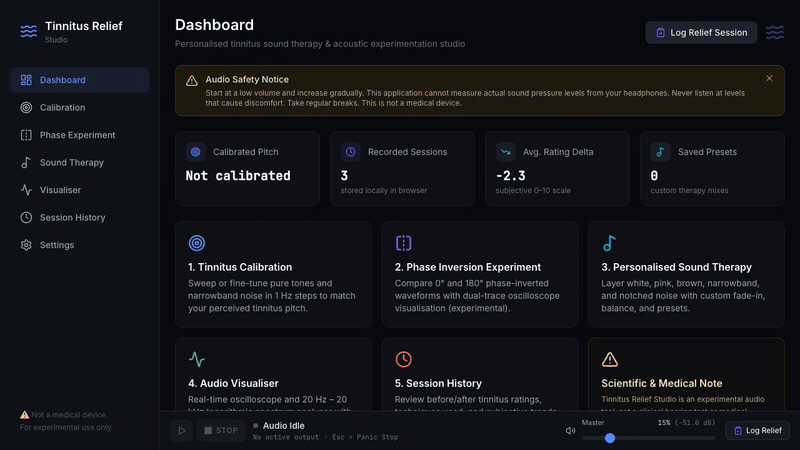

# Tinnitus Relief Studio

[](LICENSE)

A browser-based, real-time audio engineering and experimentation studio designed to help people identify the perceived pitch of their tinnitus, explore experimental acoustic techniques (including phase inversion), build personalised masking/sound-therapy mixes, and track subjective relief over time.

> **Important Scientific & Medical Disclaimer**
>
> Tinnitus Relief Studio is an **experimental audio tool**, not a medical device or clinical hearing test. It does not diagnose, treat, or cure tinnitus or any hearing condition.
>
> - **Phase inversion** operates on physical sound waves in air (destructive interference), not on internally generated tinnitus perception. Treat the Phase Inversion Experiment strictly as an exploratory feature, not a clinically validated treatment.
> - **Audio safety:** Browser volume sliders cannot measure or guarantee a safe acoustic sound pressure level (dB SPL) at your ears. Always start at a low volume, keep playback comfortable and below the level of your tinnitus, avoid prolonged exposure to loud sounds, and consult an audiologist or healthcare professional for tinnitus concerns.

---

## Preview (Silent Walkthrough)



*Silent 25-second walkthrough (no audio track) covering Dashboard, Calibration sweep & pitch lock, Phase Inversion (`0°`/`180°` dual-trace & `Sum A + B` destructive interference), Notched Pink Noise Sound Therapy, live Audio Visualiser, and Session History. Full HD silent video: [docs/demo.mp4](docs/demo.mp4).*

---

## Features

1. **Dashboard** — Overview of your calibrated tinnitus profile, session statistics, live audio monitor, and quick navigation.
2. **Tinnitus Frequency Calibration** — Match your perceived pitch across **20 Hz – 20,000 Hz** using:
   - Pure tones (`sine`, `triangle`, `square`, `sawtooth`) or narrowband noise
   - Coarse logarithmic slider, **1 Hz** / **10 Hz** fine-tuning buttons, and direct numeric input
   - Playable musical reference tones
   - Configurable logarithmic frequency sweep with instant frequency lock
   - Ear routing (`left`, `both`, `right`) and click-free 2 Hz pulsed presentation
3. **Phase Inversion Experiment** — Phase-locked oscillator split into Normal (`0°`) and Inverted (`180°` via exact `−1` polarity inversion + sub-period `DelayNode` fine offset):
   - Routing modes: `Normal (0°)`, `Inverted (180°)`, `Sum (A + B)` destructive interference verification, and `Dichotic (L / R)`
   - Independent level sliders for Signal A and Signal B
   - Dual-trace oscilloscope overlay and live cross-correlation phase readout (`Δφ`)
4. **Personalised Sound Therapy** — Live-editable multi-layer sound generator:
   - **White**, **Pink** (Paul Kellet filter), and **Brown** (leaky integrator) stereo noise buffers
   - **Narrowband noise** centred on your tinnitus frequency with RMS make-up gain
   - **Notched noise** (4th-order Butterworth low-pass + high-pass around your tinnitus pitch)
   - **Pure tones** and custom multi-layer combinations
   - Per-layer volume, stereo balance (pan), bandwidth (octaves), and smooth fade-in / fade-out
   - Quick starter profiles and local-storage favourite presets
5. **Real-Time Audio Visualiser** — Zero-re-render canvas visualisations tapped from Web Audio `AnalyserNode`s:
   - Rising zero-crossing triggered oscilloscope
   - 20 Hz – 20 kHz logarithmic spectrum analyser with saved tinnitus pitch marker
   - Real-time FFT peak frequency and relative dBFS amplitude readouts
6. **Relief Tracking & Session History** — Rate perceived tinnitus intensity (`0–10`) before and after sessions, record technique, frequency, duration, and notes, and view subjective trends in an SVG chart.
7. **Safety & Persistent Controls** — Always-accessible bottom transport bar (Pause/Resume, immediate **Stop** button + `Esc` panic shortcut, 60 dB tapered master volume with software safety cap), no autoplay, and automatic `AudioContext` cleanup.

---

## Architecture

```text
src/
├── audio/
│   ├── AudioEngine.ts      # Singleton Web Audio graph, master gain taper, limiter, analysers
│   ├── calibration.ts      # Pitch-matching tone/narrowband generator & logarithmic sweep
│   ├── phase.ts            # Phase-locked 0°/180° splitter, fine delay offset & Δφ estimator
│   ├── therapy.ts          # Live-editable multi-layer noise, narrowband, notched & tone mixer
│   ├── noise.ts            # Seamless stereo white, pink & brown noise buffer synthesis
│   └── nodes.ts            # Smooth AudioParam ramps, Butterworth filters, panner & LFO helpers
├── components/
│   ├── common/             # SafetyBanner, EmergencyStop, ReliefSessionModal
│   ├── controls/           # FrequencyControl, VolumeSlider
│   ├── layout/             # Sidebar, MobileNav, TransportBar
│   └── visualizer/         # WaveformDisplay (oscilloscope), SpectrumDisplay (log FFT)
├── hooks/                  # useEngine (useSyncExternalStore), useElapsedSeconds, usePanicHotkey
├── pages/                  # Dashboard, Calibration, PhaseExperiment, SoundTherapy, Visualiser, SessionHistory, SettingsPage
├── store/                  # AppContext (React reducer + localStorage persistence)
├── types/                  # TypeScript interfaces & defaults
└── utils/                  # Formatters, storage wrapper, musical reference tones
```

### Audio Signal Graph

```text
Program Bus (per-program fade in/out)
   └──► Mix Bus
         └──► Scope Analyser (4096)
               └──► Spectrum Analyser (8192)
                     └──► Master Gain (60 dB log taper, capped)
                           └──► Limiter (-3 dBFS clipping guard)
                                 └──► AudioContext.destination
```

All audio runs 100% client-side in the browser using the **Web Audio API** — no backend or external audio files required.

---

## Getting Started

### Prerequisites

- **Node.js** 18+ and **npm**

### Install & Run

```bash
npm install
npm run dev
```

Open the local URL printed by Vite (by default `http://localhost:5173`).

### Production Build

```bash
npm run build
npm run preview
```

---

## Tech Stack

- **React 18** + **TypeScript** + **Vite**
- **Tailwind CSS**
- **Web Audio API** (real-time DSP & analysis)
- **Lucide React** (icons)
- **LocalStorage** (preferences, tinnitus profile, therapy presets, session history)

---

## Browser Support

Tested with modern **Chrome**, **Edge**, and **Safari** (includes `webkitAudioContext` fallback, `StereoPannerNode` fallback for older Safari, and Firefox-safe `AudioParam` hold handling).

---

## Contributing

Contributions, bug reports, and ideas are welcome! Please read [CONTRIBUTING.md](CONTRIBUTING.md) before opening a pull request.

## License

Released under the [MIT License](LICENSE). Copyright © 2026 Alex Trujillo.
